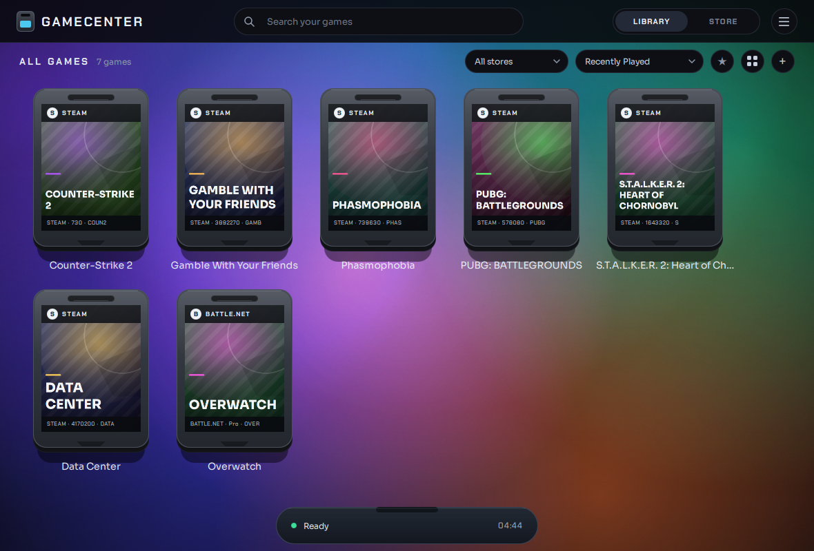

# GameCenter

Launcher de juegos **local-first** para Windows y Linux: reúne tu biblioteca,
la muestra como una estantería y lanza los juegos con un doble clic.

> Estado: **v0.18.0** - Steam, Epic, GOG, Battle.net, Riot y juegos locales. Sin cuentas, sin telemetría.



## Qué hace hoy

- Detecta **Steam, Epic Games, GOG, Battle.net y Riot** leyendo sus archivos
  locales (manifiestos, registro de Windows y `libraryfolders.vdf`).
- Lista los juegos como cartuchos con inclinación 3D al pasar el ratón.
- Usa la carátula oficial de Steam (CDN público) y la cachea; sin conexión dibuja
  una portada generada.
- **Vista de detalle** al hacer clic: modal **a pantalla completa** con un fondo
  **blur opaco translúcido** sobre la biblioteca, carátula grande, Play, tamaño,
  tiempo jugado (Steam), última partida, ruta y botones.
- **Carátula fija**: el cartucho (incluido el modelo 3D) queda anclado en la
  esquina **superior izquierda**, fuera del scroll y sin marcos que lo recorten.
  Al arrastrar sobre él **gira en cualquier dirección** (sin desplazarse); el
  visor 3D es más ancho que la tarjeta para que las esquinas no se corten en
  ninguna rotación. Doble clic para jugar.
- **Resumen del juego**: título, tienda, año, descripción, tamaño, estado de
  instalación, tiempo total, última partida, géneros y estudio. La descripción
  se obtiene de la API pública de Steam Store (AppID para Steam; búsqueda por
  título exacto para el resto), se cachea en `%APPDATA%\GameCenter\metadata.json`
  y se muestra en el idioma de la interfaz.
- **Timeline de sesiones**: debajo del resumen aparece un historial por sesión
  con fecha/hora y duración, además de una gráfica compacta de actividad y el
  tiempo total. Las sesiones se registran desde esta versión en
  `%APPDATA%\GameCenter\history.json` (también para Steam, sin tocar su
  `localconfig.vdf`).
- **Panel responsive**: el detalle se adapta al ancho de la ventana (carátula
  fija en dos columnas o vista compacta con miniatura) y el contenido se
  desplaza cuando la altura es reducida.
- **Favoritos con efecto**: la estrella del detalle tiene brillo, rebote y un
  destello animado al añadir el juego, con aviso de “Añadido a favoritos”.
- **Estadísticas**: nueva pestaña **STATS** junto a Library y Store, con filtros
  **Week / Month / Year / All time**, selector de año, resumen de tiempo jugado,
  comparación con el periodo anterior, días jugados, racha y sesiones. El
  buscador se oculta al entrar en Stats (y `Ctrl+F` solo actúa en la
  biblioteca); al pulsar fuera del buscador se quita el foco y el cursor de
  escritura. Stats es una ventana dedicada: no muestra el dock inferior
  (Ready, reloj ni cartucho insertado) ni el aviso de actualización, y usa todo
  el alto de la ventana.
- La sección de desglose adapta su granularidad al filtro: **Week → días**,
  **Month → semanas** y **Year → meses** (All time conserva el desglose mensual
  del año seleccionado). Incluye un gráfico de áreas apiladas (“a river”) con
  los juegos principales y tarjetas deslizables, **del periodo actual al más
  antiguo**. El botón **Watch** recorre las tarjetas automáticamente y **Open
  month** salta de un mes del año a su vista semanal.
  - El banner superior muestra el **juego con más horas del periodo** (con
    carátula y horas) además del tiempo total.
  - Cada tarjeta muestra la **carátula del juego más jugado** junto a su nombre
    (con tooltip de título y horas).
  - La lista de juegos es un **top 3** con numeración, carátula, horas
    detalladas en negrita y barra de proporción; el resto se agrupa en
    **Other games** con las horas resumidas y sin barra.
  - Las métricas líderes del periodo muestran un **rombo con su número en el
    mismo contenedor** (horas, días jugados y sesiones), sin insignias sueltas
    en la parte superior.
  - Cada tarjeta tiene un **banner único** con el dato más destacado:
    *Busiest month/week/day*, *Longest streak* o *Best day*.
  - El botón **Review year** abre una **presentación inmersiva estilo
    Instagram Stories** a pantalla completa: barras de progreso segmentadas,
    avance automático, pausa, navegación con teclado/mando/ratón y diapositivas
    animadas para el resumen anual, cada mes activo, el juego con más horas,
    las sesiones, la racha, el mejor día y el mes más ajetreado.
- Las estadísticas se calculan con las sesiones registradas por GameCenter; el
  tiempo anterior sin fecha no se inventa y sigue disponible como total
  histórico en la ficha de cada juego.
- **Big Picture**: modo de sofá **a pantalla completa** (sin barra de título ni
  barra de tareas), con portada grande, información del juego y un carrusel
  cinematográfico con **cuatro modos de visualización**: **Arco**, **Plano**,
  **Anillo 3D** y **Rueda vertical**.
  - Se entra desde el menú → **Big Picture**, con `Ctrl+B` o con **Start** del
    mando.
  - Mando Xbox compatible (XInput): D-pad/stick para moverse, **A** jugar,
    **B** volver, **Y/Triángulo** abrir la ficha del juego (descripción y
    timeline), **LB/RB** cambiar el modo del carrusel, **X** favorito y
    **Start** para **salir**. Mantén **Select/View** 5 segundos para capturar
    una pantalla del juego.
  - También funciona con teclado (flechas, Enter, Esc, `I`, `C`/`Tab` para el
    modo, `[`/`]` para filtros, `F` favorito) y ratón; la ficha del juego se
    abre con el botón **Details**.
  - Las carátulas se muestran **completas, sin recortes**, y la tarjeta
    seleccionada queda siempre **por encima de la barra de pistas**, sin
    solaparse, en cualquier tamaño de ventana.
  - Efecto visual moderno tipo consola: halo de acento, sombra en profundidad,
    brillo de cristal, pista del anillo y transiciones suaves entre modos.
  - La navegación se adapta al modo: arriba/abajo o izquierda/derecha para
    moverse y para cambiar de filtro según el carrusel activo.
  - La salida con Start es directa; el botón **Exit** de la esquina mantiene
    una confirmación para el ratón.
  - La barra superior es compacta para que el carrusel domine la pantalla; las
    carátulas laterales mantienen un tamaño legible.
  - El puntero del ratón se oculta al usar el mando y vuelve al mover el ratón.
  - El soporte nativo de mando usa **XInput en Windows**; en Linux o sin mando
    la interfaz funciona con teclado y ratón y la barra de pistas se adapta.
- **Favoritos** persistentes, con filtro en la barra.
- **Perfil de juego** en la ficha, independiente de la tienda:
  - **puntuación 0–100** con una barra visual y **estado** elegible entre
    *Playing, On Going, Beaten, Completed, Played, Plan to Play, On Hold,
    Not Played y Abandoned*; se guarda por ID en `profiles.json`.
  - Botón **Edit profile** en la ficha para abrir el editor; la tira de estado y
    puntuación queda siempre visible.
  - **Unificación manual entre plataformas**: el campo de origen empieza
    **vacío** y tú eliges la entrada; nada se preselecciona. Puedes elegir otra
    entrada de la biblioteca —aunque ya no aparezca en la tienda pero conserve
    datos en GameCenter— y traer sus horas, sesiones y timeline al juego actual.
  - El timeline importado se marca como **Imported**; la carátula del origen se
    guarda en `recap_covers/` para recaps y, si el destino no tiene carátula
    real, se adopta automáticamente.
  - Los juegos importados quedan listados en la ficha como trazabilidad. El
    origen se puede **ocultar tras unificar** para no duplicar estadísticas;
    se restaura desde Ajustes.
- **Dock de sesiones**: al lanzar un juego aparece con su tiempo en marcha y se
  retira solo cuando el proceso termina (o con la ×).
- **Ajustes** (engranaje o `Ctrl+,`): color de acento entre 24 opciones,
  **color de superficie** para la barra superior, el dock Ready y la estantería,
  **color de los cartuchos** y tres estilos: clásico, **Nintendo DS** y **PS2**.
  - **Capturas de pantalla del juego**: elige el atajo de teclado (por defecto
    **Ctrl + Av Pág**) y consulta la carpeta donde se guardan. Con mando, el
    atajo por defecto es **mantener Select/View 5 segundos**. En Windows el
    atajo de teclado es global, así que funciona con el juego en primer plano;
    si el sistema ya lo usa, se muestra el aviso y queda el atajo local.
  - En la vista de detalle de un juego DS puedes **arrastrar sobre el cartucho
    para girarlo en cualquier dirección** manteniendo pulsado; el modelo no se
    desplaza y el visor deja margen suficiente para que **no se corte ninguna
    esquina** al inclinarlo. El reverso muestra los contactos metálicos. En la
    biblioteca los cartuchos DS se muestran de frente y no giran. Los cartuchos
    llevan la marca **GC**.
- **Idioma de la interfaz**: en Ajustes se puede elegir entre **English,
  Español, Français, Deutsch, Italiano y Português**. El cambio es inmediato y se
  guarda en `%APPDATA%\GameCenter\settings.json`; los textos se traducen sin
  reiniciar la aplicación.
- **Animación de inserción**: al pulsar Play, el cartucho vuela desde el detalle
  y se inserta en la ranura central del dock “Ready”, que se ilumina mientras
  muestra “Inserting…”. El cartucho pasa **por detrás de la cara frontal del
  dock** y **por delante de una pletina más oscura**, de modo que se ve entrar
  de verdad en la ranura. Al terminar la animación, el cartucho **se queda
  sobresaliendo de la ranura mientras el juego está en ejecución**. Si hay
  varios juegos abiertos, la ranura muestra el último lanzado; al cerrar uno,
  pasa al siguiente y, si no queda ninguno, se oculta con un fundido.
- **Carátulas por juego con SteamGridDB**: opciones verticales paginadas, con
  cinco iniciales y **Load more** para seguir explorando; la cuadrícula se
  desplaza. La clave se guarda en el almacén de credenciales del sistema, nunca
  en el repositorio.
- **Color por cartucho**: clic derecho en una tarjeta de la biblioteca →
  **Cartridge color…** para elegir un color solo para ese juego. **Use default**
  recupera el color global.
- **Escanear tiendas**: menú superior → **Scan Steam games**, **Scan Epic
  games**, **Scan GOG games**, **Scan Battle.net games**, **Scan Riot games** o
  **Scan all stores**. Solo se reemplazan los juegos de la tienda escaneada.
  Riot incluye League of Legends, VALORANT y productos futuros mediante Riot
  Client.
- **Quitar juegos**: clic derecho en cualquier tarjeta → **Remove from library**.
  Los juegos de tienda se ocultan y se recuperan con **Restore removed games**;
  los manuales se eliminan de `manual.json`.
- **Juegos manuales**: el **+** de la barra superior abre un diálogo para poner
  título, carpeta raíz y ejecutable. Se guardan en
  `%APPDATA%\GameCenter\manual.json`, llevan la etiqueta **Local**, aparecen en
  el filtro **Local** y se pueden quitar desde el menú contextual. La carátula
  se elige después con SteamGridDB.
- **Cabecera dinámica**: al elegir una tienda o **Local**, la cabecera muestra
  la categoría y el número de juegos visibles.
- El cartucho **DS** es un objeto **3D real** (Qt Quick 3D): cuerpo fino casi
  cuadrado, con tres esquinas en pico y la inferior izquierda redondeada,
  etiqueta texturizada, muesca, **18 contactos dorados en un hueco de dos
  niveles**, marco de plástico de tres capas y separadores hasta el borde
  inferior. Solo se puede girar al abrir el detalle del juego. Los títulos van
  en negrita.
- **Tiempo jugado propio** para las tiendas que no lo registran: las sesiones
  lanzadas desde GameCenter se guardan en la raíz del juego (ver abajo).
- **Filtro de tiendas completo**: el desplegable **All stores** lista siempre
  Steam, Epic Games, GOG, Battle.net, Riot y Local, aunque una tienda todavía no
  tenga juegos instalados.
- Busca por título y filtra por tienda; ordena por **Más jugados**, reciente,
  título o tamaño.
- Lanza cada juego con el método de su tienda (URI de Steam/Epic, ejecutable o
  cliente de Riot).
- Menú contextual: lanzar, abrir carpeta, copiar App ID, color y quitar de la
  biblioteca.

## Requisitos

- Python 3.10+
- PySide6 6.6+

## Instalador (Windows)

El instalador se genera con **PyInstaller + Inno Setup**:

```powershell
powershell -ExecutionPolicy Bypass -File packaging\build_windows.ps1
```

Salidas:

- `dist\GameCenter\GameCenter.exe` — versión portable (carpeta completa).
- `dist\GameCenter-<version>-setup.exe` — instalador.

El instalador es **por usuario** (no pide administrador), instala en
`%LOCALAPPDATA%\Programs\GameCenter` y crea accesos directos. No está firmado
digitalmente, así que SmartScreen puede mostrar un aviso la primera vez.

El asistente del instalador está disponible en **inglés, español, francés,
alemán, italiano, portugués, portugués de Brasil, neerlandés, polaco, ruso y
japonés**.

El workflow `.github/workflows/release.yml` compila y publica el instalador al
empujar un tag `v*`.

## Ejecutar

```bash
pip install -e .
python -m gamecenter
```

Solo escanear (sin abrir la interfaz):

```bash
python -m gamecenter --scan
python -m gamecenter --scan --json
```

## Tests

```bash
pip install -e ".[dev]"
pytest
```

## Estructura

```
gamecenter/
  cli.py                entrada: GUI o --scan
  core/
    models.py           modelo Game
    i18n.py             catálogo de idiomas y traductor de la interfaz
    metadata.py         descripciones de Steam Store con caché local
    stats.py            agregación de historial para estadísticas
    gamepad.py          soporte XInput para Big Picture
    vdf.py              lector de VDF (formato de Valve)
    favorites.py        favoritos persistentes (JSON)
    sessions.py         seguimiento de juegos en ejecución
    screenshots.py      capturas de pantalla y atajo global
    launch.py           lanzar juegos y abrir carpetas
    sources/
      __init__.py       scan_all() aísla los fallos de cada tienda
      steam.py          manifiestos + tiempo jugado
      epic.py           manifiestos .item
      gog.py            registro GOG.com\Games
      battlenet.py      claves Uninstall de Blizzard
      riot.py           claves "Riot Game <producto>.<patchline>"
  ui/
    app.py              arranque de Qt Quick y proveedores de imágenes
    library_model.py    modelo, filtros, favoritos, orden y acciones
    artwork.py          carátulas del CDN de Steam con caché
    covers.py           portadas, fondo y logo generados con QPainter
    qml/                Main, TopBar, Toolbar, StatsView, YearReview, BigPicture, Cartridge, GameDetail, Dock
    fonts/              Sora y Chakra Petch (SIL OFL 1.1)
tools/screenshot.py     render de la ventana a PNG (desarrollo)
packaging/              PyInstaller, Inno Setup, icono y build de Windows
tests/                  parser, escáner, modelo y carga del QML
docs/CLEANROOM.md       política de reimplementación limpia
```

## Hoja de ruta

| Versión | Contenido | Estado |
|---|---|---|
| 0.1 | Steam local, búsqueda, filtros, lanzar | hecho |
| 0.2 | Epic, GOG, Battle.net, Riot | hecho |
| 0.3 | Tiempo jugado, ordenar, favoritos | hecho |
| 0.4 | Carátulas oficiales con caché y fallback generado | hecho |
| 0.5 | Vista de detalle y cartuchos 3D | hecho |
| 0.6 | Dock de sesiones y seguimiento de procesos | hecho |
| 0.7 | Heroic y Lutris (Linux) | pendiente |
| 0.8 | Empaquetado (PyInstaller/Inno Setup) y actualizaciones firmadas | hecho |

> **Nota:** Heroic Games Launcher y Lutris son launchers de Linux y se añadirán
> en una **versión posterior**. La v0.3 se centra en Windows y en las tiendas que
> ya exponen manifiestos o claves de registro locales. Ver
> [CHANGELOG.md](CHANGELOG.md).

## Seguridad

No hay claves, tokens ni cuentas en el repositorio ni en la app. Ver
[SECURITY.md](SECURITY.md) para los datos locales y cómo reportar un problema.

## Tiempo jugado

- **Steam**: se lee de `userdata/<cuenta>/config/localconfig.vdf`
  (`Playtime`, en minutos).
- **Epic, GOG, Battle.net, Riot y juegos locales**: cuando termina una sesión
  lanzada desde GameCenter se escribe un archivo en la raíz del juego:

  ```text
  .gamecenter_playtime.json
  {"seconds": 1234, "sessions": 3, "last_played": 1700000000}
  ```

  Si la carpeta no es escribible (por ejemplo, un juego en `Program Files`), el
  tiempo se guarda en `%APPDATA%\GameCenter\playtime.json`, para no perderlo.

El fallback es un **espejo**: si desinstalas y reinstalas un juego, en el
siguiente escaneo su tiempo se copia de vuelta a la nueva raíz. Los juegos de
tienda se reconocen por su id estable; los manuales, por su título, aunque
cambien de carpeta. Si la nueva carpeta tampoco es escribible, el tiempo sigue
en el fallback y se muestra igualmente.

Solo se cuentan los juegos lanzados desde GameCenter. Los de Steam no se tocan:
Steam sigue siendo la fuente de verdad para sus horas.

## Actualizaciones

La app consulta como máximo **una vez al día** la API pública de GitHub
Releases. Si hay una versión más nueva, muestra un aviso discreto y un **icono
de descarga** junto a LIBRARY/STORE. Al pulsar **Update now**, GameCenter
descarga el instalador, comprueba su **SHA-256**, lo ejecuta en silencio y se
reinicia solo. Todo ocurre dentro de la app, sin abrir GitHub.

Se puede desactivar en **Ajustes → Updates**, o comprobar manualmente con
**Check now**. La petición solo envía la IP y el `User-Agent` a
`api.github.com`; no hay telemetría.

## Privacidad

Hay dos peticiones de red, ambas opcionales:

- **Carátulas**: se envía el **AppID** de cada juego instalado al CDN público de
  Steam (`shared.akamai.steamstatic.com`) y la imagen se guarda en
  `~/.cache/gamecenter/art`.
- **Actualizaciones**: como máximo una vez al día se consulta
  `api.github.com` para ver si hay una versión nueva. El instalador solo se
  descarga si el usuario pulsa **Update now**.

No se envían cuentas, rutas ni datos del equipo.

Para que la app sea 100 % offline:

```bash
GC_NO_ART=1 python -m gamecenter
```

En ese caso se usan las portadas generadas localmente. Las carátulas son obra de
sus editores y se muestran solo para identificar el juego; no se redistribuyen.

## Interfaz

Qt Quick (QML) sobre PySide6. La ventana se compone de:

- **Cartuchos 3D**: plástico con bisel, muesca, etiqueta interior y agarre
  inferior. Al pasar el ratón se inclinan (`Rotation` en dos ejes), la etiqueta
  se mueve con paralaje y el brillo responde a la inclinación.
- **Fondo mesh**: degradado radial multicolor generado con QPainter, viñeta y
  grano, sin imágenes ni shaders.
- **Cristal**: barra superior y dock con degradados translúcidos y bordes.

## Licencia

MIT para el código. Las fuentes incluidas son SIL OFL 1.1 y Qt/PySide6 es
LGPL-3.0; ver `THIRD_PARTY_NOTICES.md`.

### Nota de reimplementación limpia

Este proyecto se escribió desde cero. No contiene código, iconos, fuentes,
texturas ni sonidos copiados de otros launchers. Solo se usaron formatos de
archivo públicos (VDF, ACF) y el comportamiento observable de un lanzador.
Ver [docs/CLEANROOM.md](docs/CLEANROOM.md).
